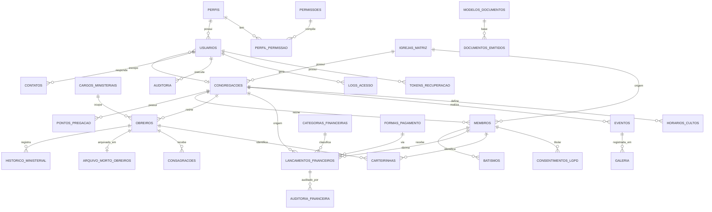

# assembleiaDeus — Arquitetura do Sistema (ETAPA 1)

> Documento de referência aprovado na Etapa 1. Nenhuma funcionalidade de etapas posteriores foi implementada aqui.
> Versão: 1.0 — Data: 2026-11-17

---

## 1. Visão geral

`assembleiaDeus` é um sistema web administrativo e institucional para gestão de um Ministério Evangélico, sua Igreja Matriz, Congregações e Pontos de Pregação.

Características arquiteturais definidas:

| Item | Decisão |
|---|---|
| Padrão | MVC com Front Controller + módulos verticais (HMVC-lite) |
| Linguagem | PHP 8.2+ (PHP puro, sem frameworks pesados) |
| Banco | MySQL (InnoDB, `utf8mb4`, `utf8mb4_unicode_ci`) |
| Acesso a dados | PDO com `PDO::ATTR_EMULATE_PREPARES = false` e prepared statements |
| Frontend | Bootstrap 5, HTML5, CSS3, JavaScript (vanilla) + AJAX via `fetch` |
| Ícones / fontes | Font Awesome 6 + Google Fonts (Inter + Playfair Display) |
| PDF | FPDF (`vendor/fpdf`) |
| QR Code | phpqrcode (`vendor/phpqrcode`) |
| Planilhas | CSV UTF-8 (compatível com Excel e com hospedagem compartilhada) |
| Ambiente alvo | XAMPP/Windows (local) e FreeHost/Ezyro (produção) |

---

## 2. Fluxo de uma requisição

```
Navegador
   │
   ▼
index.php  (site público)   |   admin/index.php  (painel)
   │
   ▼
bootstrap.php  →  Config + Env + Session + Error Handler + Autoload
   │
   ▼
Router  →  resolve rota (módulo / controlador / ação)
   │
   ▼
Middleware pipeline
   ├─ CsrfMiddleware      (POST/PUT/DELETE)
   ├─ AuthMiddleware      (somente admin)
   ├─ AclMiddleware       (perfil + escopo de congregação)
   └─ AuditMiddleware     (registra ação sensível)
   │
   ▼
Controller  →  Model (PDO)  →  View (layout + partials)
   │
   ▼
Response  →  HTML | JSON (AJAX) | PDF | CSV
```

### Convenção de rotas

| Padrão | Exemplo | Destino |
|---|---|---|
| `/` | `/` | Site → `SiteController@index` |
| `/{slug}` | `/historia` | Site → `PaginaController@show` |
| `/admin/login` | `/admin/login` | Auth → login |
| `/admin/{modulo}` | `/admin/membros` | Módulo → `index` |
| `/admin/{modulo}/{ação}` | `/admin/membros/editar/12` | Módulo → `editar(12)` |
| `/admin/{modulo}/ajax/{ação}` | `/admin/membros/ajax/buscar` | Retorno JSON |
| `/validar/{codigo}` | `/validar/ABC123` | Validação pública de carteirinha |

Reescrita de URL (`mod_rewrite`) transforma tudo em `index.php?route=...`. Em ambiente sem `mod_rewrite`, o sistema aceita `?route=` diretamente (modo de compatibilidade).

---

## 3. Estrutura de diretórios (final)

```
assembleiaDeus/
│
├── app/
│   ├── Core/                       # Motor do framework (não editar por módulo)
│   │   ├── Application.php         # Bootstrap da aplicação
│   │   ├── Router.php              # Resolução de rotas
│   │   ├── Controller.php          # Classe base dos controllers
│   │   ├── Model.php               # Classe base dos models (CRUD PDO)
│   │   ├── View.php                # Renderização com layouts
│   │   ├── Database.php            # Factory PDO (singleton por request)
│   │   ├── Request.php             # Entrada HTTP (GET/POST/JSON/arquivos)
│   │   ├── Response.php            # Saída HTML/JSON/PDF/CSV + redirect
│   │   ├── Session.php             # Sessão segura (regenerate, timeout)
│   │   ├── Auth.php                # Autenticação + "trocar senha"
│   │   ├── Acl.php                 # RBAC + escopo por congregação
│   │   ├── Csrf.php                # Geração/validação de token
│   │   ├── Flash.php               # Mensagens sucesso/erro
│   │   ├── Validator.php           # Validação servidor
│   │   ├── Upload.php              # Upload seguro (tipo/tamanho/nome)
│   │   ├── Audit.php               # Log de auditoria e acesso
│   │   ├── Env.php                 # Leitor simples de .env (sem lib)
│   │   ├── Config.php              # Acesso a config/app.php etc.
│   │   ├── Paginator.php           # Paginação reutilizável
│   │   └── Pdf.php                 # Wrapper FPDF
│   │
│   ├── Controllers/                # Controllers compartilhados
│   │   ├── SiteController.php      # Home, páginas institucionais
│   │   ├── PaginaController.php
│   │   ├── EventoPublicoController.php
│   │   ├── ContatoController.php
│   │   ├── ValidacaoController.php # QR/código de carteirinha
│   │   ├── AuthController.php      # Login, logout, recuperação
│   │   └── DashboardController.php
│   │
│   ├── Models/                     # Models compartilhados / cross-cutting
│   │   ├── Usuario.php
│   │   ├── Perfil.php
│   │   ├── Permissao.php
│   │   ├── Configuracao.php
│   │   ├── Auditoria.php
│   │   └── TokenRecuperacao.php
│   │
│   ├── Helpers/
│   │   ├── helpers.php             # e(), url(), asset(), old(), csrf_field()
│   │   ├── format.php              # moeda, data, CPF, CNPJ, telefone
│   │   ├── qrcode.php              # wrapper phpqrcode
│   │   └── documentos.php          # montagem de PDFs institucionais
│   │
│   ├── Middleware/
│   │   ├── MiddlewareInterface.php
│   │   ├── CsrfMiddleware.php
│   │   ├── AuthMiddleware.php
│   │   ├── AclMiddleware.php
│   │   └── AuditMiddleware.php
│   │
│   └── Views/
│       ├── layouts/
│       │   ├── site.php            # Cabeçalho + banner + rodapé público
│       │   ├── admin.php           # Sidebar + topbar + conteúdo
│       │   ├── auth.php            # Login / recuperação
│       │   ├── print.php           # Relatórios para impressão
│       │   └── documento.php       # Diplomas, cartas, carteirinhas
│       ├── partials/
│       │   ├── alerts.php
│       │   ├── pagination.php
│       │   ├── confirm_modal.php   # Confirmação antes de excluir
│       │   └── form_errors.php
│       ├── site/
│       │   ├── home.php
│       │   ├── historia.php
│       │   ├── missao-visao-valores.php
│       │   ├── palavra-pastoral.php
│       │   ├── igrejas.php
│       │   ├── congregacoes.php
│       │   ├── pontos-pregacao.php
│       │   ├── eventos.php
│       │   ├── galeria.php
│       │   ├── contato.php
│       │   └── validar-carteirinha.php
│       ├── admin/
│       │   ├── dashboard.php
│       │   ├── login.php
│       │   ├── esqueci-senha.php
│       │   ├── redefinir-senha.php
│       │   ├── trocar-senha.php
│       │   ├── perfil.php
│       │   ├── usuarios/
│       │   ├── auditoria/
│       │   └── (demais pastas espelham os módulos)
│       └── documents/
│           ├── carta_convite.php
│           ├── diploma_batismo.php
│           ├── diploma_consagracao.php
│           └── carteirinha/{classico,moderno,horizontal,vertical,institucional,qrcode}.php
│
├── config/
│   ├── app.php                     # Nome, fuso, locale, paths, paginação
│   ├── database.php                # Lê credenciais de getenv()/.env
│   ├── permissions.php             # Matriz perfil × permissão
│   └── mail.php                    # SMTP (contato e recuperação)
│
├── admin/
│   └── index.php                   # Front controller do painel
│
├── public/
│   ├── assets/
│   │   ├── css/{bootstrap.min.css,app.css,admin.css,documentos.css}
│   │   ├── js/{app.js,admin.js,charts.js}
│   │   ├── images/{logo.png,banner.jpg,placeholder.jpg}
│   │   ├── fonts/
│   │   └── vendor/                 # Bootstrap/Font Awesome locais (offline)
│   └── uploads/
│       ├── membros/
│       ├── obreiros/
│       ├── igrejas/
│       ├── eventos/
│       ├── galeria/
│       └── documentos/
│
├── includes/
│   ├── header.php                  # Cabeçalho público reutilizável
│   ├── navbar.php                  # Menu público
│   ├── sidebar.php                 # Menu lateral do painel (filtrado por ACL)
│   └── footer.php                  # Rodapé institucional
│
├── modules/                        # Vertical slices (lógica por funcionalidade)
│   ├── membros/{Controller.php,Model.php,routes.php}
│   ├── obreiros/{...}
│   ├── arquivo_morto/{...}
│   ├── igrejas/{...}
│   ├── congregacoes/{...}
│   ├── pontos_pregacao/{...}
│   ├── financeiro/{...}
│   ├── cartas_convite/{...}
│   ├── batismos/{...}
│   ├── consagracoes/{...}
│   ├── carteirinhas/{...}
│   ├── diplomas/{...}
│   ├── eventos/{...}
│   ├── relatorios/{...}
│   ├── configuracoes/{...}
│   └── seguranca/{...}
│
├── storage/                        # FORA da web (bloqueado por .htaccess)
│   ├── documentos/                 # PDFs gerados
│   ├── logs/                       # logs/*.log por dia
│   └── backups/                    # dumps .sql
│
├── database/
│   └── ezyro_43462517_gestao_igreja.sql   # criado na ETAPA 2
│
├── docs/
│   └── ARQUITETURA.md              # este documento
│
├── vendor/
│   ├── fpdf/
│   └── phpqrcode/
│
├── index.php                       # Front controller público
├── bootstrap.php                   # Carregamento comum
├── .htaccess                       # Rewrites + bloqueios
├── .env.example                    # Modelo de credenciais (sem senha real)
├── .env                            # Real (nunca versionar / nunca público)
└── README.md                       # ETAPA 23
```

### Regras de organização

1. **Core** (`app/Core`) contém apenas infraestrutura; não conhece regras de negócio.
2. **Módulos** (`modules/<nome>`) contêm `Controller.php`, `Model.php` e `routes.php`. Suas telas ficam em `app/Views/admin/<nome>/` (views centralizadas, sem duplicidade).
3. **Models** estendem `Core\Model` e herdam `find`, `all`, `create`, `update`, `delete`, `paginate`.
4. **Controllers** estendem `Core\Controller` e declaram `permissions()` para alimentar o `AclMiddleware`.
5. Nenhum módulo acessa `$_POST` diretamente: usa-se `Core\Request`.
6. Nenhum módulo escreve SQL com concatenação de variável do usuário.

---

## 4. Planejamento dos módulos

| # | Módulo | Responsabilidade | Tabelas principais | Acesso mínimo |
|---|---|---|---|---|
| 1 | `configuracoes` | Identidade visual, dados do ministério, cores, modelos | `configuracoes`, `redes_sociais`, `modelos_documentos` | Administrador Geral |
| 2 | `igrejas` | Igreja Matriz | `igrejas_matriz` | Secretário (leitura) / Admin (escrita) |
| 3 | `congregacoes` | Congregações | `congregacoes`, `horarios_cultos` | Secretário (leitura) / Admin (escrita) |
| 4 | `pontos_pregacao` | Pontos de pregação | `pontos_pregacao`, `horarios_cultos` | Secretário / Admin |
| 5 | `membros` | CRUD, ficha, carteirinha, export | `membros`, `carteirinhas` | Secretário |
| 6 | `obreiros` | CRUD, cargos, histórico, transferências | `obreiros`, `cargos_ministeriais`, `historico_ministerial` | Pastor Presidente |
| 7 | `arquivo_morto` | Desligamento preservado + restauração | `arquivo_morto_obreiros` | Pastor Presidente (restaurar: Superadmin) |
| 8 | `financeiro` | Dízimos, ofertas, entradas, saídas, auditoria | `lancamentos_financeiros`, `categorias_financeiras`, `formas_pagamento`, `auditoria_financeira` | Tesoureiro |
| 9 | `batismos` | Registro histórico + diploma | `batismos`, `documentos_emitidos` | Pastor Presidente |
| 10 | `consagracoes` | Registro histórico + diploma | `consagracoes`, `documentos_emitidos` | Pastor Presidente |
| 11 | `diplomas` | Modelos e emissão de diplomas | `modelos_documentos`, `documentos_emitidos` | Pastor Presidente |
| 12 | `cartas_convite` | Geração de cartas em PDF | `modelos_documentos`, `documentos_emitidos` | Secretário |
| 13 | `carteirinhas` | 6 modelos, QR, 2ª via, validação | `carteirinhas`, `documentos_emitidos` | Secretário |
| 14 | `eventos` | Cultos, congressos, campanhas | `eventos`, `galeria`, `horarios_cultos` | Secretário |
| 15 | `relatorios` | 12 relatórios + PDF/CSV | (agrega todos) | conforme relatório |
| 16 | `seguranca` | Usuários, perfis, permissões, logs, backup, LGPD | `usuarios`, `perfis`, `permissoes`, `auditoria`, `logs_acesso`, `consentimentos_lgpd` | Superadministrador |
| 17 | `site` (app/Controllers) | Página pública dinâmica | `paginas`, `noticias`, `eventos`, `configuracoes` | público |

---

## 5. Níveis de acesso (RBAC)

| Perfil | Nível | Escopo de dados |
|---|---:|---|
| Superadministrador | 100 | Global + segurança, backups, restaurações |
| Administrador Geral | 90 | Global (exceto chaves de segurança e backup) |
| Pastor Presidente | 80 | Global em membros/obreiros/documentos; finanças só leitura |
| Pastor de Congregação | 70 | Restrito à `congregacao_id` do usuário |
| Secretário | 60 | Restrito à congregação (cadastros e documentos) |
| Tesoureiro | 50 | Financeiro global + relatórios financeiros |
| Obreiro autorizado | 10 | Leitura de eventos e própria ficha |

**Escopo de dados (`Acl::escopo()`)**: além da permissão da ação, o Model aplica automaticamente `WHERE congregacao_id = :id` para perfis com escopo restrito. Isso evita vazamento entre congregações mesmo quando a rota é conhecida.

**Regras especiais**:
- Alterar/excluir lançamento financeiro já registrado → apenas Administrador Geral ou superior, com auditoria obrigatória.
- Restaurar obreiro do arquivo morto → apenas Superadministrador.
- Trocar senha no primeiro acesso é obrigatório (`usuarios.must_change_password = 1`).

---

## 6. Modelo de dados inicial (entidades e relacionamentos)

> Detalhamento de colunas, índices e FKs será feito na **ETAPA 2**. Aqui estão apenas as entidades e os relacionamentos.

### 6.1 Identidade e segurança

| Entidade | Descrição |
|---|---|
| `perfis` | 7 níveis fixos |
| `permissoes` | Ações granulares (`membros.criar`, `financeiro.editar`, …) |
| `perfil_permissao` | N:N perfil ↔ permissão |
| `usuarios` | Login, senha hash, perfil, congregação, foto, `must_change_password` |
| `tokens_recuperacao` | Hash do token, expiração, uso único |
| `logs_acesso` | Login, logout, falhas, IP, user-agent |
| `auditoria` | Tabela, registro, antes/depois, usuário, IP |
| `consentimentos_lgpd` | Titular, finalidade, consentimento, data, IP |

### 6.2 Estrutura eclesiástica

| Entidade | Descrição |
|---|---|
| `igrejas_matriz` | Dados institutionais da Casa Matriz |
| `congregacoes` | N:1 com `igrejas_matriz` |
| `pontos_pregacao` | N:1 com `congregacoes` |
| `horarios_cultos` | Polimórfico: igreja **ou** congregação **ou** ponto |

### 6.3 Pessoas

| Entidade | Descrição |
|---|---|
| `membros` | N:1 com `congregacoes` e `igrejas_matriz` (origem) |
| `cargos_ministeriais` | Cargos fixos + cadastráveis pelo painel |
| `obreiros` | N:1 com `cargos_ministeriais` e `congregacoes` |
| `historico_ministerial` | N:1 com `obreiros` (cargo, congregação, data) |
| `arquivo_morto_obreiros` | 1:1 com `obreiros` (motivo, data, responsável) — **não exclui** o original |

### 6.4 Finanças

| Entidade | Descrição |
|---|---|
| `categorias_financeiras` | Entrada / Saída |
| `formas_pagamento` | Dinheiro, Pix, TED, boleto, cartão… |
| `lancamentos_financeiros` | Dízimo, oferta, entrada, saída; `membro_id` opcional |
| `auditoria_financeira` | Toda alteração de lançamento |

### 6.5 Sacramentos e documentos

| Entidade | Descrição |
|---|---|
| `batismos` | N:1 com `membros` e pastor celebrante |
| `consagracoes` | N:1 com `obreiros`, cargo e pastor presidente |
| `modelos_documentos` | HTML dos 4 tipos de documento |
| `documentos_emitidos` | Número, destinatário, PDF, QR, emissor |
| `carteirinhas` | Modelo, código, validade, 2ª via, vínculo membro/obreiro |

### 6.6 Conteúdo público

| Entidade | Descrição |
|---|---|
| `paginas` | História, missão, visão, valores, palavra pastoral (slug único) |
| `noticias` | Notícias e eventos em destaque na home |
| `eventos` | `publicar_site = 1` → aparece automaticamente no site |
| `galeria` | Fotos (N:1 opcional com evento) |
| `redes_sociais` | Links do rodapé |
| `contatos` | Mensagens do formulário público |

### 6.7 Diagrama ER (visão inicial)



### 6.8 Regras de integridade (resumo)

- `ON DELETE RESTRICT` para estrutura (igreja/congregação não podem ser excluídas se houver membros).
- `ON DELETE SET NULL` para responsáveis pastorais e ofertante opcional.
- `ON UPDATE CASCADE` em FKs de código/cargo quando aplicável.
- `arquivo_morto_obreiros.obreiro_id` com `UNIQUE` — um obreiro só pode ser arquivado uma vez; restauração reativa o registro original.
- `lancamentos_financeiros` nunca sofre `DELETE` lógico sem registro em `auditoria_financeira`.
- Todas as tabelas com `created_at` e `updated_at`, exceto tabelas pivot e de log.

---

## 7. Convenções de código

| Item | Convenção |
|---|---|
| Tabelas | `snake_case`, plural (`membros`, `lancamentos_financeiros`) |
| Chave primária | `id INT UNSIGNED AUTO_INCREMENT` |
| Chave estrangeira | `<entidade_no_singular>_id` (`congregacao_id`) |
| Classes | `PascalCase` (`MembroController`, `ArquivoMortoModel`) |
| Métodos | `camelCase` (`buscarPorCodigo`) |
| Variáveis | `snake_case` ou `camelCase` (padronizar `camelCase` no JS, `snake_case` no PHP) |
| Views | `kebab-case.php` |
| Rotas | `kebab-case` |
| Constantes | `UPPER_SNAKE_CASE` |
| Mensagens | `Flash::success()`, `Flash::error()`, `Flash::warning()` |
| Exclusão | sempre via `confirm_modal.php` + POST + CSRF |

---

## 8. Segurança (desenho, implementação nas etapas 3 e 14)

- `.env` fora do DocumentRoot quando possível; no FreeHost, protegido por `.htaccess` (`<FilesMatch "^\.env"> Require all denied </FilesMatch>`).
- Diretórios sensíveis (`app`, `config`, `modules`, `storage`, `database`, `includes`, `vendor`) com `.htaccess` negando acesso e `index.php` vazio como fallback.
- `password_hash(PASSWORD_ARGON2ID)` com fallback `BCRYPT`; rehash automático no login.
- CSRF token em **todo** formulário e validado no `CsrfMiddleware`.
- Saída HTML sempre com `e()` (`htmlspecialchars`).
- Prepared statements em toda consulta com dado do usuário.
- Upload: whitelist MIME real (`finfo`), extensão controlada, tamanho ≤ 2 MB, nome gerado por hash, fora de `public/` quando sensível.
- Sessão: `session_regenerate_id(true)` no login, `HttpOnly`, `SameSite=Lax`, `secure` em produção.
- Rate limiting simples de login por IP + session (tabela `logs_acesso`).
- Auditoria de alterações em financeiro, obreiros, arquivo morto e usuários.
- LGPD: consentimento registrado, minimização de dados, exportação/exclusão controlada, senha e CPF mascarados em telas de listagem.

---

## 9. Estratégia de ambientes

| Item | Local (XAMPP) | Produção (FreeHost/Ezyro) |
|---|---|---|
| URL | `http://localhost/assembleiaDeus/` | `https://seudominio.ezyro.com/` |
| DB | `localhost`, usuário `root` | `sql303.ezyro.com`, usuário `ezyro_43462517` |
| Nome DB | `ezyro_43462517_gestao_igreja` | igual |
| Senha | vazia/local no `.env` | definida no `.env` (nunca no git) |
| DocumentRoot | `htdocs/assembleiaDeus` | `htdocs/` do host |
| Assets | `/assembleiaDeus/public/assets` | reescrito para `/assets` via `.htaccess` |
| Modo debug | `APP_DEBUG=true` | `APP_DEBUG=false` |
| Erros | exibidos | gravados em `storage/logs/` |

**Banco configurado**: `ezyro_43462517_gestao_igreja` / usuário `ezyro_43462517` / servidor `sql303.ezyro.com` / senha apenas via `.env`.

---

## 10. Roadmap (15 etapas)

| Etapa | Entrega | Status |
|---:|---|:---:|
| 1 | Arquitetura, diretórios, planejamento, ER inicial | **CONCLUÍDA** |
| 2 | SQL completo (tabelas, FKs, índices) | **CONCLUÍDA** |
| 3 | PDO, config, `.env`, bootstrap, autoload | **CONCLUÍDA** |
| 4 | Página pública institucional | **CONCLUÍDA** |
| 5 | Login, ACL, painel, dashboard | **CONCLUÍDA** |
| 6 | Igrejas, congregações, pontos | **CONCLUÍDA** |
| 7 | Membros e obreiros | **CONCLUÍDA** |
| 8 | Arquivo morto | **CONCLUÍDA** |
| 9 | Financeiro | pendente |
| 10 | Batismos, consagrações, diplomas | pendente |
| 11 | Cartas-convite e carteirinhas | pendente |
| 12 | Eventos e programação | pendente |
| 13 | Relatórios e configurações | pendente |
| 14 | Segurança, testes, auditoria | pendente |
| 15 | Publicação FreeHost/Ezyro | pendente |

---

## 11. Como validar a ETAPA 8

1. Acessar `/admin/arquivo-morto` com um usuário que possua `arquivo_morto.ver`.
2. Em `/admin/arquivo-morto/arquivar`, selecionar um obreiro elegível, informar data, motivo e observações.
3. Confirmar que o obreiro original passa para a situação `ARQUIVADO`, que o registro aparece no arquivo morto e que um evento `DESLIGAMENTO` é registrado no histórico.
4. Abrir a ficha histórica e confirmar que os dados e o histórico anteriores ao desligamento foram preservados.
5. Confirmar que um Administrador Geral (perfil 2) vê o módulo e pode arquivar, mas não vê o botão de restaurar; a rota de restauração direta deve retornar `403`.
6. Com o Superadministrador, restaurar o obreiro e confirmar que a situação volta para `ATIVO`, que o evento `RETORNO` é registrado e que o filtro `RESTAURADO` localiza o registro.
7. Confirmar que um obreiro restaurado não pode ser arquivado novamente, pois o vínculo único do arquivo morto é preservado.
8. Confirmar ausência de overflow horizontal em 390px nas telas de listagem, ficha e formulário.
9. Executar `php -l` em todos os arquivos PHP do projeto.

**Próximo passo (somente após autorização): ETAPA 9 — financeiro.**
